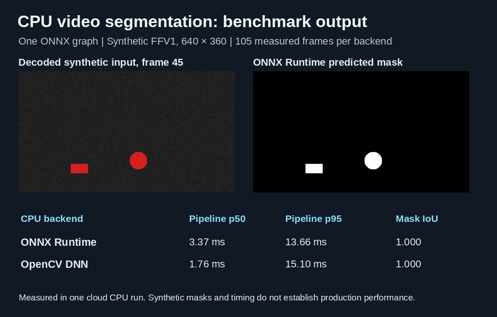

# CPU Video Segmentation Benchmark

## Verified run output



This image was rendered from the checked-in measured JSON report and an actual decoded fixture frame and model mask. See the installation and run commands below to reproduce the experiment.

A reproducible computer-vision systems demo: run **the same tiny ONNX graph** using ONNX Runtime CPU and OpenCV DNN CPU, then see how much time goes into decoding, preprocessing, inference, and postprocessing.

```text
Deterministic scene generator ──► FFV1 video ──► OpenCV decoder
          │                                       │
          └─► geometric mask (oracle)              ▼
                                      normalized BGR NCHW tensor
                                                  │
                                    ┌─────────────┴─────────────┐
                                    ▼                           ▼
                            ONNX Runtime CPU                OpenCV DNN CPU
                                    │                           │
                                    └─────► threshold logits ◄───┘
                                                      │
                                          mask IoU against oracle
```

## Run it

Use Python 3.12. Tested on Linux x86-64 with the OpenCV Python wheel's FFmpeg backend. The default synthetic clip takes about 62 MB on disk.

```bash
python -m venv .venv
source .venv/bin/activate  # Windows PowerShell: .venv\Scripts\Activate.ps1
python -m pip install -r requirements.txt
python -m unittest -v
python benchmark.py --frames 120 --warmup 15 --backend both --out out
```

For the exact dependency versions tested on Linux x86-64/Python 3.12, install `requirements-linux-py312.lock` instead. The script creates the clip, model, and `out/report.json`; it does not download footage or weights. The ONNX graph uses one hand-set 1×1 convolution to score how strongly red a pixel is. The ground truth comes from the shapes' geometry, not from the model.

An optional Dockerfile is included, but the image has not been built or run here:

```bash
docker build -t cpu-video-segmentation .
docker run --rm cpu-video-segmentation --frames 60 --warmup 10
```

## Example run

[Raw JSON report](examples/report.json). Measured on an AMD EPYC 9V74 cloud Linux VM, Python 3.12.14, 105 measured frames per backend after 15 warm-up frames, 640×360 FFV1 input.

| Backend | Inference p50 / p95 | Pipeline p50 / p95 | Pipeline FPS | Mask IoU |
|---|---:|---:|---:|---:|
| ONNX Runtime CPU | 2.26 / 2.94 ms | 3.37 / 13.66 ms | 165.8 | 1.000 |
| OpenCV DNN CPU | 0.80 / 1.01 ms | 1.76 / 15.10 ms | 157.7 | 1.000 |

OpenCV DNN had lower median inference latency in this run, but decode latency was variable (p95 was 10.90 ms for the ONNX Runtime run and 13.60 ms for the OpenCV DNN run). Do not infer an overall backend winner from this single sequential run. To compare seriously, repeat the runs, alternate backend order, and use representative input and models.

Pipeline timing covers synchronous frame read through mask threshold; it excludes session setup, fixture creation, metric calculation, rendering, and report writing. FPS divides measured frames by their summed pipeline times; it is **not** wall-clock throughput for the full script or camera FPS. Inference timing includes the backend call and its Python-side input/output handoff. ORT intra-op and OpenCV thread settings are set to one; FFmpeg can manage codec threads independently. IoU micro-aggregates foreground intersections and unions across measured frames.

## Scope and provenance

AI-assisted portfolio prototype. This is an inference and measurement exercise, not model training, a real-world segmentation validation, or a production speed claim. The perfect IoU is expected on inputs designed for the rule. No personal data, downloaded model weights, or third-party footage are included. No license is granted here for third-party dependencies; they retain their own terms.

References: [ONNX Runtime Python API](https://onnxruntime.ai/docs/api/python/api_summary.html), [ORT thread management](https://onnxruntime.ai/docs/performance/tune-performance/threading.html), and [OpenCV video I/O](https://docs.opencv.org/4.x/d8/dfe/classcv_1_1VideoCapture.html).
