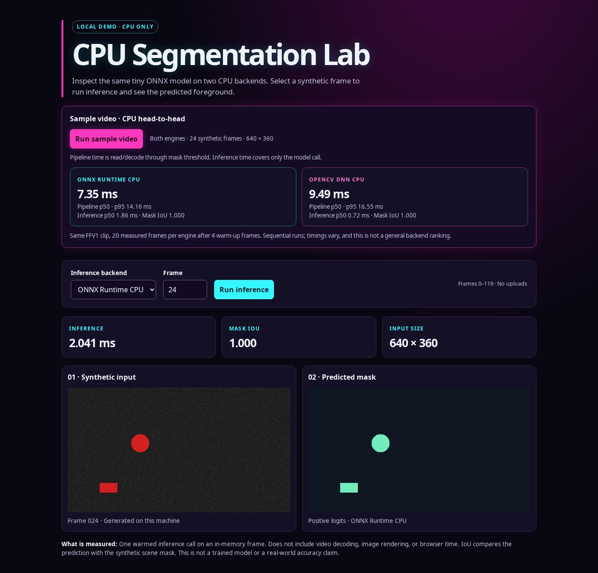
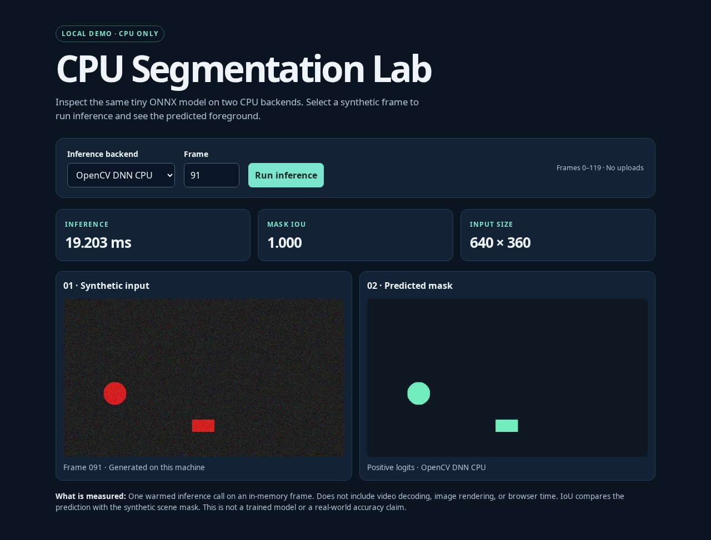
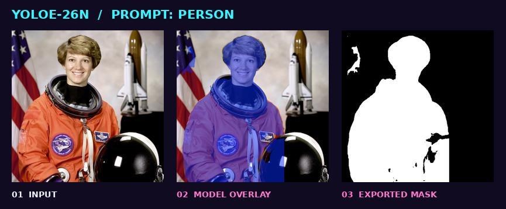

# CPU Video Segmentation Benchmark

A reproducible computer-vision systems demo: run **the same tiny ONNX graph** using ONNX Runtime CPU and OpenCV DNN CPU, then see how much time goes into decoding, preprocessing, inference, and postprocessing.



The comparison screenshot shows real timings captured after clicking **Run sample video**. The original GUI screenshot below shows the single-frame workflow.



The screenshot captures a real local GUI run on frame 91 with OpenCV DNN CPU. Its single-run inference time varies across runs and is not part of the benchmark table below.

## Segment what you want with Ultralytics YOLOE-26

Type object names such as `person, bus` to produce instance masks from a local image. Change the prompt to change the target, without retraining or relying on a fixed class list. This is useful for inspecting new scenes and quickly drafting annotations; verify masks before using them as ground truth.



Example: real `yoloe-26n-seg.pt` CPU output for the prompt `person`. Input photo: [NASA, Eileen Collins, public-domain sample distributed by scikit-image](https://scikit-image.org/docs/stable/api/skimage.data.html#skimage.data.astronaut). The mask is a prediction, not a reference annotation.

### Install the optional prompt lab

Use Python 3.12 and Git on your PATH. **Use a separate virtual environment**: YOLOE uses `opencv-python`, while the original benchmark uses `opencv-python-headless`.

```bash
python -m venv .venv-yoloe
source .venv-yoloe/bin/activate  # Windows PowerShell: .venv-yoloe\Scripts\Activate.ps1
python -m pip install torch torchvision --index-url https://download.pytorch.org/whl/cpu
python -m pip install -r requirements-yoloe.txt
```

The PyTorch command above is for CPU installs on Linux/Windows. On macOS use the [PyTorch installation instructions](https://pytorch.org/get-started/locally/). The desktop GUI needs Tkinter (on Linux, install your distribution's Python Tk package if missing). First setup needs network access for dependencies, the official checkpoint, and the text encoder (about 254 MB). Run from the same directory to reuse the downloaded model files. Your images are read and processed on your machine; this app does not upload them.

### Interactive desktop GUI

```bash
python prompt_gui.py
```

Open a local image, enter comma-separated object names, then click **Segment**. The side-by-side preview shows the input and mask overlay. Adjust the terms and run again on the same image. **Export masks** saves an overlay, one full-resolution binary PNG per instance, and a JSON report. No server is started. The GUI uses the nano checkpoint and CPU.

### Command line

```bash
python prompt_segment.py path/to/image.jpg --prompts "person, bus" --imgsz 384 --out out/prompt-demo
python -m unittest -v test_prompt_segment
```

The output directory must be new. `result.json` records the prompts, image dimensions, instance labels and confidence scores, and time spent in the model's prediction call, which can include warm-up on first use. An empty prediction is valid: the original image is written as the overlay and the instance list is empty. Use `--conf` to adjust the minimum confidence, `--imgsz` for the input resolution, or `--model yoloe-26s-seg.pt` to try the larger small model. Large inputs use a reduced instance limit to bound the memory cost of full-resolution masks; resize first if you need more instances per image. Text prompts work best as short object-category names rather than instructions.

This PyTorch demo is **separate from the existing synthetic ONNX benchmark**. Its timings are not comparable to the ONNX backend table, and no real-world accuracy metric is claimed. Visual-box prompting, prompt-free mode, video, and retraining are not part of this demo. Model weights are downloaded from Ultralytics rather than checked into the repo. Review [Ultralytics YOLOE usage and model documentation](https://docs.ultralytics.com/models/yoloe/) and [its licensing terms](https://www.ultralytics.com/license) before redistribution or commercial deployment.

## Interactive GUI: CPU Segmentation Lab

After installing the dependencies using the setup instructions below, launch the local browser GUI:

```bash
python gui.py
```

Open **http://127.0.0.1:8765/** on the same computer (or run `python gui.py --open` to launch your default browser). This command is the same in Windows PowerShell, macOS, and Linux once the virtual environment is active. Verified on Linux x86-64; Windows and macOS were not tested here. Use `--port 0` if the default port is busy and open the URL printed by the program. Press **Ctrl+C** in the terminal to stop it.

Choose a CPU backend and a frame index (0–119), then click **Run inference**. The app generates the selected frame in memory, runs the same checked ONNX graph as the benchmark, and shows the actual predicted mask, its synthetic IoU, and the elapsed time for that single warmed inference call. Unlike the benchmark below, this time excludes video decoding and is not a p50/p95 statistic.

Click **Run sample video** to create a short local FFV1 video and run both engines on the same clip. The comparison shows median (p50) and p95 per-frame latency from video read/decode through the predicted mask threshold, plus inference-only p50 and synthetic IoU. It uses 24 generated frames (4 warm-ups, 20 measured per backend). This is a fresh measurement each time, separate from the 120-frame published benchmark; the two engines run in sequence. A short run is not a definitive backend ranking.

The server listens only on `127.0.0.1`, accepts no uploads, and uses no network services, real footage, or remote assets. Install dependencies once before running offline. It is a local demo, not a production web server.

## Verified benchmark output


This image was rendered from the checked-in measured JSON report and an actual decoded fixture frame and model mask. See the installation and run commands below to reproduce the experiment.

```text
Deterministic scene generator ──► FFV1 video ──► OpenCV decoder
          │                                       │
          └─► geometric mask (oracle)              ▼
                                      normalized BGR NCHW tensor
                                                  │
                                    ┌─────────────┴─────────────┐
                                    ▼                           ▼
                            ONNX Runtime CPU                OpenCV DNN CPU
                                    │                           │
                                    └─────► threshold logits ◄───┘
                                                      │
                                          mask IoU against oracle
```

## Run it

Use Python 3.12. Tested on Linux x86-64 with the OpenCV Python wheel's FFmpeg backend. The default synthetic clip takes about 62 MB on disk.

```bash
python -m venv .venv
source .venv/bin/activate  # Windows PowerShell: .venv\Scripts\Activate.ps1
python -m pip install -r requirements.txt
python -m unittest -v
python benchmark.py --frames 120 --warmup 15 --backend both --out out
```

For the exact dependency versions tested on Linux x86-64/Python 3.12, install `requirements-linux-py312.lock` instead. The script creates the clip, model, and `out/report.json`; it does not download footage or weights. The ONNX graph uses one hand-set 1×1 convolution to score how strongly red a pixel is. The ground truth comes from the shapes' geometry, not from the model.

An optional Dockerfile is included, but the image has not been built or run here:

```bash
docker build -t cpu-video-segmentation .
docker run --rm cpu-video-segmentation --frames 60 --warmup 10
```

## Example run

[Raw JSON report](examples/report.json). Measured on an AMD EPYC 9V74 cloud Linux VM, Python 3.12.14, 105 measured frames per backend after 15 warm-up frames, 640×360 FFV1 input.

| Backend | Inference p50 / p95 | Pipeline p50 / p95 | Pipeline FPS | Mask IoU |
|---|---:|---:|---:|---:|
| ONNX Runtime CPU | 2.26 / 2.94 ms | 3.37 / 13.66 ms | 165.8 | 1.000 |
| OpenCV DNN CPU | 0.80 / 1.01 ms | 1.76 / 15.10 ms | 157.7 | 1.000 |

OpenCV DNN had lower median inference latency in this run, but decode latency was variable (p95 was 10.90 ms for the ONNX Runtime run and 13.60 ms for the OpenCV DNN run). Do not infer an overall backend winner from this single sequential run. To compare seriously, repeat the runs, alternate backend order, and use representative input and models.

Pipeline timing covers synchronous frame read through mask threshold; it excludes session setup, fixture creation, metric calculation, rendering, and report writing. FPS divides measured frames by their summed pipeline times; it is **not** wall-clock throughput for the full script or camera FPS. Inference timing includes the backend call and its Python-side input/output handoff. ORT intra-op and OpenCV thread settings are set to one; FFmpeg can manage codec threads independently. IoU micro-aggregates foreground intersections and unions across measured frames.

## Scope and provenance

AI-assisted portfolio prototype. This is an inference and measurement exercise, not model training, a real-world segmentation validation, or a production speed claim. The perfect IoU is expected on inputs designed for the rule. No personal data, downloaded model weights, or third-party footage are included. No license is granted here for third-party dependencies; they retain their own terms.

References: [ONNX Runtime Python API](https://onnxruntime.ai/docs/api/python/api_summary.html), [ORT thread management](https://onnxruntime.ai/docs/performance/tune-performance/threading.html), and [OpenCV video I/O](https://docs.opencv.org/4.x/d8/dfe/classcv_1_1VideoCapture.html).
